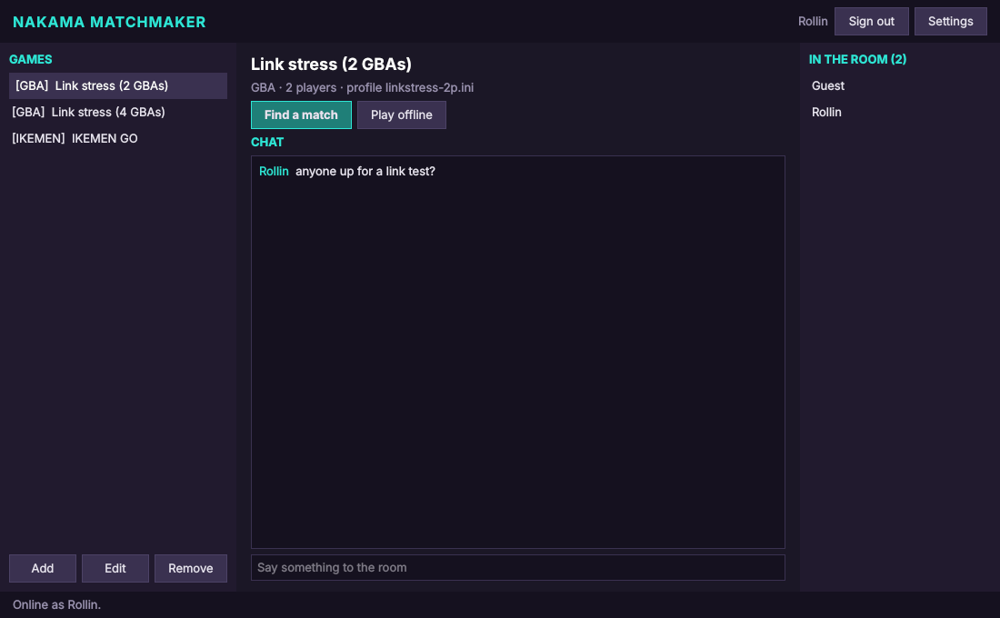

# Nakama Matchmaker

Nakama Matchmaker is a launcher that finds online opponents through a [Nakama](https://heroiclabs.com/nakama/) server and starts the game. It can also run that server: a *community server* for the players of IKEMEN GO, of GBA games or of DS games, started from its window or from the command line ([docs/hosting.md](docs/hosting.md)). It serves three engines:

- **mGBA** (Game Boy Advance), through the mGBA fork at [RollinJay/mgba](https://github.com/RollinJay/mgba) with its netplay changes;
- **melonDS** (Nintendo DS), through the melonDS fork at [RollinJay/melonDS-test](https://github.com/RollinJay/melonDS-test) and its online play with rollback;
- **IKEMEN GO**, through its Nakama fork at [RollinJay/IkemenGo-Nakama](https://github.com/RollinJay/IkemenGo-Nakama).

Its window is laid out like Fightcade's: the games on the left, the chosen game's chat room in the middle, the players in that room on the right, and buttons that find a match, start the game with its own online menus, or start it offline, and, for an IKEMEN GO game, show its leaderboard.



The repository also holds **netplay-online**, the library that the launcher and the mGBA fork share: a Nakama client, direct UDP connections between players, and the file that hands a match from the launcher to an emulator. The melonDS fork does the same with code of its own: it reads the same file, and sends the same messages and connection handshake ([docs/protocol.md](docs/protocol.md)).

## What the forks add

Each fork keeps its upstream program and license, and adds online play through a Nakama server, with *rollback*: the players' computers connect directly to each other and send only the players' inputs; each computer runs the whole game, goes on without waiting for the other players' inputs, and when an input arrives that differs from its guess, goes back a few frames and runs them again.

**The mGBA fork** ([about this fork](https://github.com/RollinJay/mgba#about-this-fork)) adds rollback netplay, through GekkoNet, for one to four Game Boy Advance consoles, which a game may link with the link cable; each player's computer emulates every console and the cable. A *netplay profile* names the game's ROMs, how the consoles are linked and which console each player controls. mGBA-qt's netplay window (Tools > Netplay...) finds matches on a Nakama server by itself, and opens the matches that the launcher finds. The fork also draws a wider picture for ROM hacks that declare margins around the GBA's 240×160 screen, and emulates the GBA's own screen size and video timing again, which an earlier build of the fork had changed.

**The melonDS fork** ([about this fork](https://github.com/RollinJay/melonDS-test#about-this-fork)) adds the local wireless multiplayer of DS games, played over the internet by two players, with rollback through GGPO. Both players need the same dump of the game: melonDS compares the two ROMs' hashes before it starts. Its online window (System > Multiplayer > Play online (rollback)...) has a *channel* for each game, with who is there, chat and challenges, which needs the fork's channel module (Lua code that the Nakama server runs); its quick match meets the launcher's Find a match. melonDS can also start signed in as the launcher's player, or with a match that the launcher found.

**The IKEMEN GO fork** ([about this fork](https://github.com/RollinJay/IkemenGo-Nakama#about-this-fork)) adds quick and ranked online matches, found by the server's matchmaker, and lobbies of up to eight players, with tournaments. Ranked players play sets of matches (best of three by default), and each set changes their Elo ratings once. The server takes a set's result only from its two players; when their claims differ, or one is missing, the set is disputed, and the server's moderators decide it, with the replays that the server keeps. Players see a level computed from their rating, on a scale that the server's creator sets, and each game has a leaderboard. The fork's server modules, which this repository also holds (`server/modules`), serve the launcher and the mGBA fork too.

## Nightly builds

The [nightly release](https://github.com/RollinJay/Nakama-Matchmaker/releases/tag/nightly) holds builds of `main`, made on each night after new commits: for Linux (x86_64; built on Ubuntu 22.04, so it needs glibc 2.35 or newer), an AppImage of the launcher and a tarball of `nakama-matchmaker-server`; for Windows (x86_64), a zip of both programs; for macOS (Apple silicon, macOS 15 or newer), a zipped app that holds both programs (the server program is `Nakama Matchmaker.app/Contents/MacOS/nakama-matchmaker-server`). Each package includes the server modules that a community server installs; Nakama and PostgreSQL, which a community server also needs, are not included ([docs/hosting.md](docs/hosting.md#what-a-server-needs)). They are automatic builds, not stable releases, and `SHA256SUMS.txt` lists their checksums. The nightly workflow only checks that the Windows and macOS programs start and find the server modules; beyond that, the Windows and macOS builds are untested ([Status](#status)). The macOS app is not notarized by Apple, so macOS blocks its first start until it is allowed in System Settings > Privacy & Security. The forks have nightly releases of their own, described in their "About this fork".

## How a match is made

1. Each player signs in to the Nakama server with an account tied to the computer (a random device id kept in the settings) and opens a game. Opening a game joins its chat room.
2. **Find a match** (mGBA and DS games) asks the emulator for the game's *identity*. For an mGBA game it is a hash of the emulator build, the netplay profile, and every ROM and save the profile names; for a DS game, a hash of the ROM and of the version of the melonDS fork's online protocol. Two players can only play each other when their identities are equal, so the identity is what the matchmaker pairs on, and it also names the room.
3. When the matchmaker has enough players, the launcher writes the match to a private file and starts the emulator with the file's path in the `NETPLAY_CONNECT` environment variable ([docs/launch.md](docs/launch.md)).
4. The emulator joins the match as the same player, with a new session of the account that the launcher signed in for, connects to the other players directly over UDP, and plays the game with rollback: the mGBA fork through [GekkoNet](https://github.com/HeatXD/GekkoNet), the melonDS fork through its own rollback netplay (GGPO). Only the players' inputs travel between computers; every computer runs every console. The launcher stays in the room, and becomes ready for the next match when the emulator exits.

IKEMEN GO and the melonDS fork also have online menus of their own. **Play online** starts them with a *server profile*, a private file that names the launcher's server and account, so they sign in as the same player:

- IKEMEN GO (`-nakama-config`, `-nakama-server`): its online menus (quick and ranked matches, lobbies) make the matches. IKEMEN GO cannot join a match found elsewhere, so for an IKEMEN GO game, Play online is the launcher's only online button.
- the melonDS fork (`--netplay-config <file> --netplay-online <ROM>`): melonDS opens its online window, signed in, in the game's *channel* on the server: who is there, chat, and challenges between players. Its quick match adds the same matchmaker ticket as the launcher's Find a match, so the players who look for an opponent in melonDS and those who look in the launcher find each other. melonDS stays open for more games until the player closes it; the launcher is ready again then.

## Games

| Kind | Program | Where matches are made | Players |
|---|---|---|---|
| `mgba` | mGBA fork built with `USE_NETPLAY` | the launcher | 2 to 4, as the profile's link needs |
| `melonds` | the melonDS fork (rollback netplay) | the launcher (Find a match), or melonDS's online window (Play online): its game channels and quick match | 2 |
| `ikemen` | IKEMEN GO Nakama fork | IKEMEN GO's online menus | as in IKEMEN GO |

An mGBA game is a *netplay profile*: an INI file of the emulator fork that names the ROMs, how the consoles are linked, and which console each player's keys go to. The mGBA fork's `doc/netplay.md` describes its profiles. A profile that names its ROMs through environment variables (`${VAR}`), as the fork's examples do, needs those variables in the launcher's environment, which the emulator inherits; a profile of one's own can name the files' paths instead.

A DS game is a ROM: a `.nds` file, or an archive that holds one (`game.zip`, or `game.zip|game.nds` for one ROM of several), as melonDS opens it. The melonDS fork at [RollinJay/melonDS-test](https://github.com/RollinJay/melonDS-test) plays it online with rollback (GGPO), with two players; its `docs/NETPLAY.md` describes it. The launcher starts it in three ways:

- **Find a match**: the launcher asks melonDS for the ROM's identity (`--netplay-identity <ROM>`), finds the opponent, and hands melonDS the match in `NETPLAY_CONNECT`;
- **Play online**: melonDS's own online window, as above. Its game channels need a server with the fork's channel module, such as a DS community server ([docs/hosting.md](docs/hosting.md)); its quick match, like Find a match, works on any Nakama server;
- **Play offline**: melonDS with the ROM alone (`<melonDS> <ROM>`).

Players can also open melonDS without the launcher (System > Multiplayer > Play online (rollback)...) and meet the launcher's players: through quick match, which meets the launcher's Find a match, or in the game's channel, where the launcher's players who pressed Play online are.

## Leaderboard

For an IKEMEN GO game, **Leaderboard** lists the game's ranked players on the launcher's server, highest rating first: their rank, name and level, and the ranked sets they won and lost, 50 at a time (**More** shows the next ones), with the player's own place under the list. It needs the launcher signed in, the game's IKEMEN GO game id (`game` in the game list) and a server with the IKEMEN GO fork's server modules, such as a community server ([docs/hosting.md](docs/hosting.md)).

The level is what the server shows for a player's Elo rating: the rating itself, or the levels that the server's creator set, such as a power level that starts at 9,001 and reaches the billions ([docs/hosting.md](docs/hosting.md#ikemen-gos-ranked-levels)). IKEMEN GO shows the same level while it looks for a ranked match, and its change on the screen after a ranked set when the set's result comes while that screen shows; the change of a set that a moderator decides later shows on the leaderboard, not in the game ([docs/hosting.md](docs/hosting.md#ikemen-gos-ranked-levels)).

## Building

The launcher needs CMake 3.16 or later, a C++14 compiler, and Qt 6 or Qt 5.10 or later (Core, Network, Widgets).

```
cmake -B build
cmake --build build
```

This builds `build/launcher/nakama-matchmaker`, `build/launcher/nakama-matchmaker-server` (the community servers without a window, [docs/hosting.md](docs/hosting.md)) and the test tool `build/netplay-online-test`. `-DBUILD_TOOLS=OFF` leaves the test tool out, `-DBUILD_SERVER=OFF` the server program. `-DBUILD_LAUNCHER=OFF` builds the server program alone, which needs only Qt's Core and Network modules, for a computer without a desktop.

## Setting up

**Settings** holds the player's name, the server (host, port, server key, TLS), the STUN servers that tell each player its public address, and where the programs are: the mGBA fork's `mgba-qt`, the melonDS fork's executable and IKEMEN GO's executable.

The settings (`settings.ini`) and the game list (`games.json`) are kept in the configuration folder: `~/.config/nakama-matchmaker` on Linux, `%LOCALAPPDATA%\nakama-matchmaker` on Windows and `~/Library/Preferences/nakama-matchmaker` on macOS. `--config` selects another folder.

**Add** and **Edit** fill in the game list. Each game in `games.json` has these fields:

| Field | Kinds | Meaning |
|---|---|---|
| `id` | all | Letters, digits and dashes; unique in the list |
| `title` | all | The name in the list |
| `kind` | all | `mgba`, `melonds` or `ikemen` |
| `profile` | `mgba`, `melonds` | Path of the netplay profile (`mgba`), or the ROM (`melonds`; the field keeps the name `profile` so that earlier game lists still load) |
| `players` | `mgba` | Players per match (a `melonds` game always has 2) |
| `game`, `build` | `ikemen` | The IKEMEN GO pool the account plays in; `game` also names the game's leaderboard |
| `workdir` | all | Folder to start the program in (IKEMEN GO's folder by default) |
| `args` | all | Extra arguments for the program |
| `command` | all | Program and arguments to run instead of the configured program |
| `identity_command` | `mgba`, `melonds` | Program and arguments that print the identity; `{profile}` stands for the `profile` field's path |

Without `identity_command`, the launcher runs `<emulator> --netplay-identity <profile>`, with the program set in the settings: `mgba-qt` for an mGBA game, the melonDS fork for a DS game. [docs/games.example.json](docs/games.example.json) shows an mGBA game, a DS game, IKEMEN GO, and a headless test entry that uses `command` and `identity_command`.

Player names are unique on the server. When another account already has the name, the account gets the name followed by a tag made from the device id, such as `Ryu#3fa0`; the tag stays the same at every sign-in.

## Command line

| Option | Meaning |
|---|---|
| `--config <folder>` | The configuration folder |
| `--name <name>` | Player name (saved) |
| `--device <id>` | Device id to sign in with (saved); one account per id |
| `--host <host>`, `--port <port>` | Nakama server (saved) |
| `--auto <game id>` | No window: sign in, find a match for that game (for IKEMEN GO: start it as Play online does), play it, and exit with the game's exit code |
| `server <command>` | No window: run and manage community servers ([docs/hosting.md](docs/hosting.md)); `nakama-matchmaker-server <command>` does the same |

## The server

Any Nakama 3 server with the IKEMEN GO fork's server modules serves the launcher, the mGBA fork and IKEMEN GO alike. The melonDS fork's matches (the launcher's and its quick match's) need nothing more; its game channels need its own channel module. Nakama Matchmaker can run such a server itself, set up for the community's games, from its **Servers** window or its `server` commands ([docs/hosting.md](docs/hosting.md)); [docs/server.md](docs/server.md) describes setting one up by hand.

## Documents

- [docs/launch.md](docs/launch.md): the file that hands a match from the launcher to an emulator.
- [docs/protocol.md](docs/protocol.md): accounts, IKEMEN GO's leaderboards, rooms, matchmaking, the messages inside a match, the direct connections between players, and melonDS's game channels.
- [docs/server.md](docs/server.md): the Nakama server, set up by hand.
- [docs/hosting.md](docs/hosting.md): community servers that Nakama Matchmaker runs, the moderation of IKEMEN GO's ranked sets on them, and the levels their IKEMEN GO players see for their ratings.

## Testing

`netplay-online-test` checks the library against a server without an emulator: run it on two (or more) terminals with different `--device` ids and the same `--players`; each one signs in, matchmakes, joins, connects directly to the others, measures the round trip, exchanges a chat line, and prints `OK`.

```
build/netplay-online-test --device test-device-one --name one
build/netplay-online-test --device test-device-two --name two
```

Two launchers with `--auto` and separate `--config` folders test the whole path, including the start of the emulator. Running an emulator fork's headless player as the game's `command` makes the run headless: the mGBA fork's `mgba-netplay-online-test` plays a fixed number of frames with scripted keys and prints a checksum of every console's memory, which must be equal for every player (`--trace` writes one per frame).

The melonDS fork has no headless player: two launchers with `--auto` and a DS game start two melonDS windows (on a desktop, or a virtual display such as Xvfb; `SDL_AUDIODRIVER=dummy` silences them), which play until one is closed. melonDS writes what the session did to its output, which the launcher passes on (`netplay: ... desync checks passed`), and exits with status 0 after a session that a player left; the launchers exit with that status. A melonDS window that asks for a quick match with a server profile, `melonDS --netplay-config <profile> --netplay-quick --netplay-exit <ROM>`, meets a launcher's `--auto` the same way.

## Status

Tested on Ubuntu 24.04 with Qt 5.15 and Qt 6.4 against Nakama 3.41.0, with every player on one computer:

- mGBA fork: two players (two linked GBAs) and three players (three linked GBAs) matched, launched, connected and played to identical checksums, headless; two `mgba-qt` windows played a match started by two launchers;
- melonDS fork (rollback), with a small homebrew test ROM, so a game's own DS wireless play was not part of these tests: on a DS community server and on a server with IKEMEN GO's modules, two launchers with `--auto` started two melonDS windows with the match they found, which connected and played until one melonDS was closed, every desync check passing, and melonDS and both launchers exited with status 0; a launcher with `--auto` and a melonDS window's quick match found each other and played the same way. On the DS server, from the launcher's window, Play online opened melonDS's online window signed in as the launcher's account in the game's channel, its quick match met another launcher's Find a match, and melonDS stayed in the channel after that game until it was closed; Play offline started melonDS with the ROM;
- the launcher's window: sign-in, rooms, chat, matchmaking, starting the game and returning when it exits, and an IKEMEN GO game's leaderboard (with sets settled through the server modules' RPCs, not by IKEMEN GO itself);
- community servers, and the moderation of IKEMEN GO's ranked sets: see [docs/hosting.md](docs/hosting.md#tested-and-not).

Not yet tested: players on different networks behind real NATs, Windows and macOS builds, and starting IKEMEN GO from the launcher.

## Limitations

- The direct connections use STUN only. A player behind a symmetric NAT cannot connect to one behind a symmetric or port-restricted NAT; a relay (TURN, or relaying through the Nakama match) is not implemented.
- Every player in a match needs every other player's inputs, so the match ends when any player leaves.
- The account belongs to the computer: there is no sign-in with email or another provider, and moving to another computer means a new account.
- The launcher does not make IKEMEN GO's matches; IKEMEN GO has no option to join a match found elsewhere.

## License

MIT (see [LICENSE](LICENSE); `netplay-online/LICENSE` holds the same text for the forks' copies). netplay-online is MIT so that emulator forks under other licenses can include it, as the mGBA fork (MPL 2.0) does.

The server modules in `server/modules` are MIT too ([server/modules/README.md](server/modules/README.md)): IKEMEN GO's, and the melonDS fork's channel module, which contains no melonDS code. The emulator forks themselves keep their own licenses (mGBA: MPL 2.0, melonDS: GPL 3.0).
